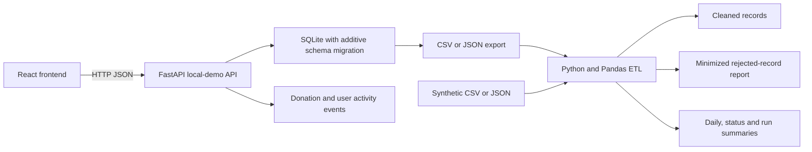
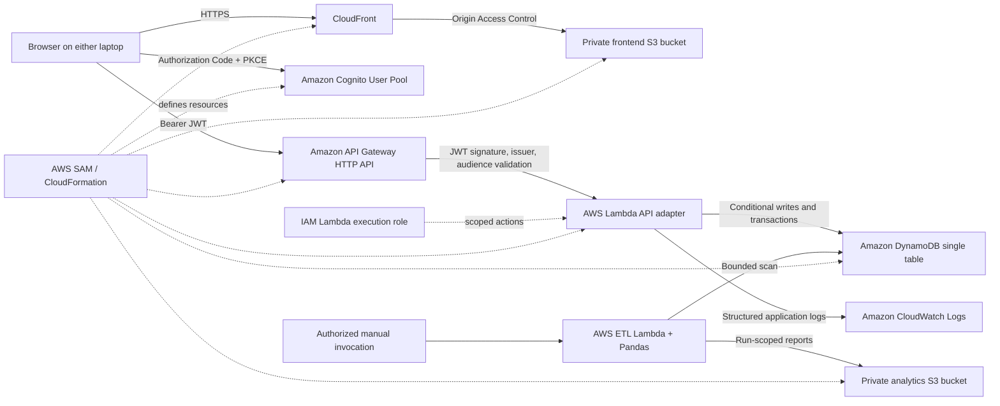

# Architecture

## Design and operating modes

This is a local-first teaching application. The local baseline uses synthetic demo identities, FastAPI, SQLite, React, and Pandas; it does not require AWS credentials. The AWS target is implemented in SAM and has been reviewed with local tests and template tooling, but it is not deployed. A read-only check on 2026-10-29 verified the configured non-root IAM Identity Center role and found no CloudFormation stacks, Lambda functions, or DynamoDB tables in `ap-south-1`. The only listed S3 bucket is `smartslot-datalake`, which is unrelated and must not be used or modified.

### Local baseline

Local demo profiles are fixed, predictable identities and are not authentication. They are enabled only by `APP_MODE=local-demo` and `VITE_AUTH_MODE=local-demo` during Vite development. Do not enter real personal or sensitive data. SQLite startup migrations add missing fields/tables and preserve existing donation rows.

### AWS target (implemented in the template, not deployed)

The diagram describes the actual template and source flow, not a successful deployment or a zero-cost recommendation. The frontend S3 origin is private behind CloudFront OAC; the browser never receives AWS credentials. Cognito authorizes the API with JWTs. The separate manually invoked ETL Lambda reads bounded records from DynamoDB and writes run-scoped reports to the private analytics bucket. No ETL schedule is configured. Account-plan eligibility, credits, allowances, pricing, and live service behavior remain unverified. The template permits local development callback/CORS origins as well as the generated CloudFront domain.

## AWS service responsibilities and boundaries

| Service | Proposed responsibility | Current boundary |
|---|---|---|
| Amazon Cognito | Public SPA client, managed sign-in, email verification, and role groups | Template only. Self-registration can create an identity, but exactly one trusted group must be assigned by an administrator. AWS user search/suspension workflows are not implemented. Email/managed-login costs and eligibility are unverified. |
| Amazon API Gateway HTTP API | Verify bearer JWT signature, issuer, and app-client audience before Lambda | Template only; no live tokens or requests tested. |
| AWS Lambda | Validate API payloads, derive actor from verified `sub`/group claims, call repository | Adapter and repository are mock-tested, not live-integrated. |
| Amazon DynamoDB | Store donations and audit events; conditional state transitions and atomic donation/event transactions | One table with five GSIs: `status-index`, `donor-index`, `recipient-index`, `entity-index`, and `expiry-index` (deadline-ordered due listings). User profile management is not cloud-backed. Administrative analytics and list export stop at 500 donations. |
| Amazon S3 | Separate private frontend origin and ETL report storage | Both application buckets are template resources with public access blocked, encryption, and ownership controls; neither has been created. The separate private SAM artifact bucket is provisioned for deployment packaging. The local ETL upload path remains explicit and separate from the cloud ETL Lambda. |
| Amazon CloudFront | HTTPS delivery of the static frontend from the private S3 origin using OAC | Distribution is defined by the template; no live URL or distribution has been verified. Requests, transfer, and invalidations can incur charges. |
| AWS IAM | Scope Lambda to table item actions, five index queries, and bounded log writes | Runtime policy is in the template. Scoped GitHub deployment/review and CloudFormation roles, OIDC provider, and runtime boundary are provisioned; no application stack is deployed. |
| Amazon CloudWatch | Store Lambda logs with configured 7-day retention | No live logs, metrics, or alarms. Log ingestion and storage may incur charges. |
| AWS SAM / CloudFormation | Define the stack and outputs, including frontend, API, Cognito, and ETL resources | Template validation/build have passed locally. No stack or change set exists. The workflow requires a separately approved, pre-created artifact bucket and will not use `--resolve-s3`. |
| Amazon SNS / EventBridge | Notifications and scheduled processing | Not selected. Expiry is manually invoked and bounded; no schedule or notifications configured. |
| AWS Glue / Athena | Possible managed ETL/query extension | Not included; local Pandas remains the baseline. |

Review current account/region prices and all side effects before any separately approved AWS activity. See [COST_AND_SECURITY.md](./COST_AND_SECURITY.md).

## Data model and access patterns

### Local SQLite

- `donations`: authoritative listing and lifecycle state.
- `donation_events`: backend-generated event timeline, indexed by entity and descending event time.
- `user_profiles`: fixed synthetic demo roles/statuses; not a production identity store.
- Startup performs additive `ALTER TABLE` operations only for missing fields and creates tables/indexes if absent. Existing rows are not reset, and automated tests use temporary databases.
- Donation mutation and corresponding event are written in one SQLite transaction. Existing rows do not receive fabricated historical events.

### DynamoDB single-table layout

- Base primary key: partition key `id` (string). Donation items use their donation ID; event items use `event#<uuid>`.
- `status-index`: partition `status_pk`, sort `status_sk`; supports available/status lists and bounded admin aggregates.
- `donor-index`: partition `donor_pk`, sort `donor_sk`; donor-owned listings.
- `recipient-index`: partition `recipient_pk`, sort `recipient_sk`; recipient's claims.
- `entity-index`: partition `entity_pk`, sort `entity_sk`; chronological history for one donation/user entity.
- `expiry-index`: partition `status_pk`, sort `deadline_sk`; selects due available listings without walking the newest available donations. This extra GSI adds storage, write, and query costs.
- Donation and audit event are written in a DynamoDB transaction for supported mutations; conditional writes enforce current status, ownership and claim deadline. A losing claim cannot create a success event.
- List APIs use bounded pages (maximum 100). Admin analytics/export queries statuses in pages and fail if more than 500 records are needed. This is a classroom limit, not a scalable analytics architecture.
- GSI projections are `ALL`, which increases stored index bytes and write amplification. Each index can add cost and must be included in the review.
- There is no live user profile table or Cognito admin-management client. Cognito group membership is the cloud role authority.

## Lifecycle and history

`available -> claimed -> picked_up` is the normal path. An available donation can be cancelled or expire; a claim is rejected after its deadline even if the bounded expiry processor has not yet run. The local expiry operation is repeat-safe and uses a SQLite status/deadline index. Cloud expiry is an authenticated/admin-triggered bounded operation that queries the deadline-ordered `expiry-index`; EventBridge scheduling is not configured. This additional GSI has a cost impact.

Audit events include backend actor, UTC timestamp, before/after status, limited structured metadata, and request ID. The audit timeline is an application log, not an independently verified immutable ledger. Event access follows donation participation or local-admin authorization. Failed transitions do not write success events.

## Analytics definitions

- Claim rate = `(claimed + picked_up) / all donations in the selected created-date/category/location population`; a status-only display filter does not change this rate cohort.
- Completion rate = `picked_up / all donations in that population`.
- Expiry rate = `expired / (picked_up + cancelled + expired)` in that population; zero when no terminal records.
- Available count includes only records in `available` state with pickup deadlines later than the current UTC time.
- Food quantity redistributed = quantities from `picked_up` records only, grouped by the source unit for both overall and daily views. Units are not converted.
- Average time to claim = mean `claimed_at - created_at` for timezone-aware, non-negative claim durations; invalid/missing pairs are omitted.
- Daily charts use the UTC calendar date prefix from normalized timestamps.
- Local user counts represent the fixed synthetic profile table. Cloud user counts are unavailable (`null`). Admin metrics use application data (up to 500 records in the cloud repository), not the ETL snapshot.
- These values do not prove food waste prevented or physical delivery beyond an authorized pickup confirmation.

## Security boundaries

- Local identity switching is a demo convenience and grants synthetic local roles; it must not be used as real authentication.
- The production target uses Cognito OIDC authorization code + PKCE and session-scoped browser storage. API Gateway validates JWTs; Lambda derives `sub` and exactly one recognized `cognito:groups` role from the authorizer context.
- Self-registration does not grant a role. There is no API for users to assign groups or promote themselves.
- Local synthetic profile suspension is enforced by FastAPI, but cloud suspension/revocation is not implemented. Do not describe the cloud target as providing that feature.
- DynamoDB and audit behavior are mocked/tested locally only. No AWS credentials, resources, uploads, console evidence, or GitHub Actions runs were used in this work.
